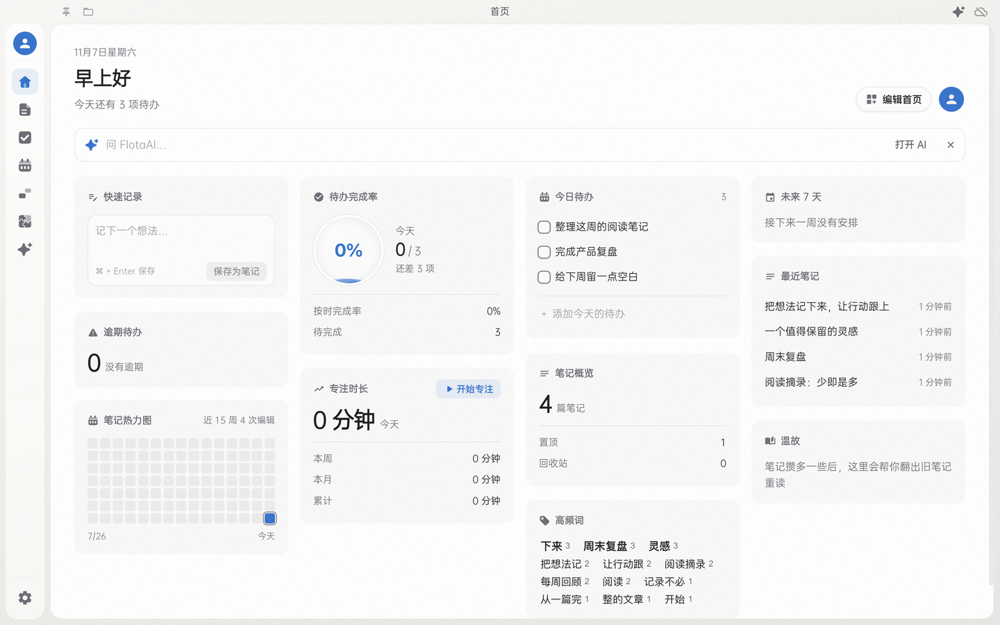
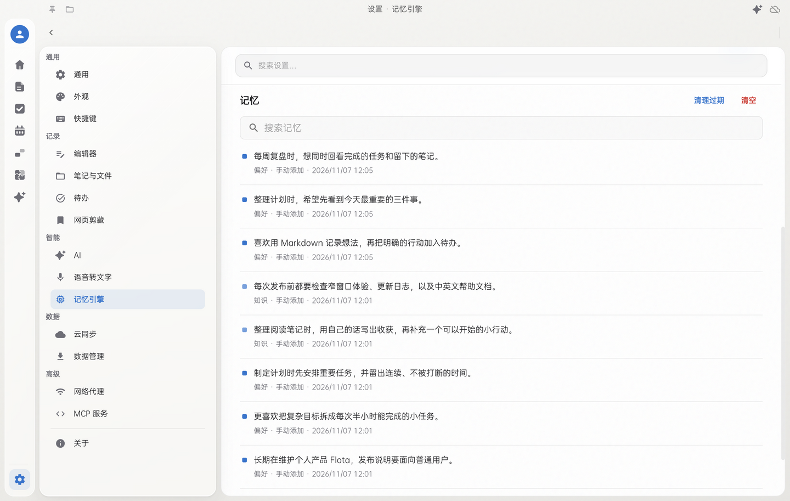
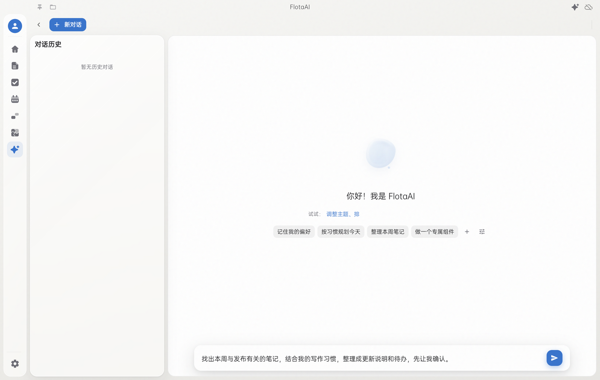
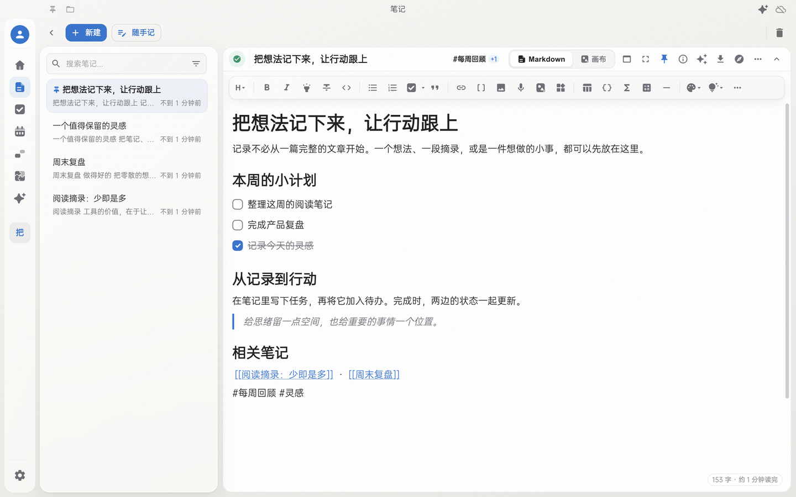
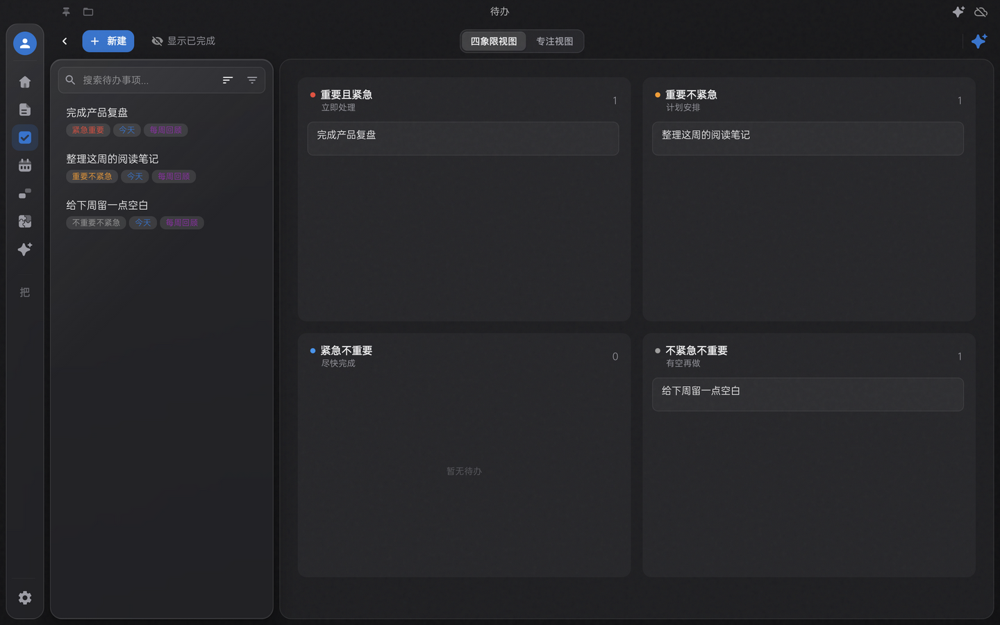

<div align="center">

[中文](./README.md) · [English](./README_EN.md)


# Flota

**越用越懂你的个人 Agent。**

把笔记、待办、画布和 AI 放在一起。记下想法，也让它逐渐记住你的偏好与习惯，陪你把事情往前推进。

[下载桌面版](https://github.com/Xperiamol/Flota/releases) · [快速开始](#快速开始) · [更新日志](./CHANGELOG.md) · [隐私政策](./PRIVACY.md)


[](https://github.com/Xperiamol/Flota/releases)

</div>



## 记得你，也能帮你做事

不用每次都从自我介绍开始。告诉 Flota 你习惯怎样写作、希望怎样得到回答、长期在做什么；在后续对话中，AI 可以参考这些记忆，给出更贴近你的建议。

### 越用越懂你，来自可管理的长期记忆

- **记住有用的习惯**：开启自动记忆后，从对话中筛选值得长期保留的偏好、身份和习惯；也可以直接说「记住这件事」。
- **需要时再想起来**：结合当前问题和相关记忆，减少反复交代背景。偏好变了，也可以让它更正。
- **记忆由你掌握**：在设置中查看、搜索、编辑或删除记忆；可以关闭自动记忆，也可以在对话里撤销一次记忆更新。



截图中的记忆是手动加入的演示数据。记忆保存在本机；AI 提取和使用记忆时，相关内容会发送给你配置的 AI 服务。

### 从问答到行动，围绕你的资料工作

让它找出相关笔记、读完全文，再整理成计划；从笔记中提取待办，修改已有画布，或生成一个可以放在首页使用的组件。写入操作默认先给出确认卡，供你审核后执行。

你可以这样开始：

> 「记住：我喜欢先给结论，再列三条重点。」
>
> 「找出本周与发布有关的笔记，整理成待办，先让我确认。」
>
> 「把这份计划画成流程图，保留已有内容，只补上缺少的步骤。」



上图展示自定义的 Prompt 快捷方式和待发送草稿，未调用外部 AI。AI 功能需要自行配置服务地址与密钥；能力和回答质量取决于所选模型。

## 从记录到下一步

- **笔记与待办连在一起**：在笔记里写任务，一键加入待办，勾选和改名两边同步；也可以嵌入单条待办或动态清单。
- **用你习惯的方式表达**：所见即所得与 Markdown 源码编辑、双链、标签、公式、代码块，以及基于 Excalidraw 的画布。
- **看见内容之间的联系**：知识图谱连接双链、插入的笔记链接和相同标签；时间轴与日历帮助回看记录。
- **首页按自己需要摆放**：快速记录、今日待办、最近笔记、专注与热力图等卡片，也支持添加组件。
- **数据由你掌握**：本机保存笔记与附件；按需启用 WebDAV 同步、多网盘备份、历史版本，以及 CalDAV / Google Calendar 日历同步。

## 界面预览

以下截图来自 4.5.4 版本的代码，使用独立演示数据。

### 笔记：写下内容，也写下要做的事



### 待办：按轻重缓急安排下一步



## 快速开始

### 下载安装

前往 [GitHub Releases](https://github.com/Xperiamol/Flota/releases)，选择与你的系统和处理器匹配的安装包：

| 平台 | 安装方式 |
| --- | --- |
| Windows 10 及以上 | 下载 Windows 安装程序 |
| macOS | 下载对应 Apple Silicon（arm64）或 Intel（x64）的 DMG，拖入「应用程序」 |
| Linux x64 | 下载 AppImage，授予可执行权限后运行；需要系统具备 AppImage 运行环境 |

Microsoft Store 渠道的应用名称为 **Flota Notes**，该版本由商店负责更新。不同渠道的安装包以实际发布内容为准。Android 版独立发布，本页介绍桌面版。

### 第一次使用

1. 按 `Ctrl/Cmd + N` 新建笔记；`Ctrl/Cmd + Shift + N` 打开快速输入。
2. 按 `Ctrl/Cmd + T` 新建待办，或把笔记中的任务「加入待办」。
3. 在设置中按需配置 AI、同步和语音识别；基础记录不需要账号或密钥。
4. 在首页添加需要的卡片。快捷键可以在设置中调整。

### 还能做什么

- **网页剪藏**：通过 Chrome / Edge 扩展保存网页全文、选中内容或书签。[安装与配对](./extensions/chrome-clipper/README.md)
- **语音转文字**：支持本机 Whisper 离线识别，以及自行配置凭据的火山引擎云端识别。离线模型需要先下载。
- **导入与导出**：导入 Markdown、Office 文档、PDF、EPUB 等内容；支持导出与本地备份。
- **历史版本**：在设置中启用后保留笔记快照，按需查看或恢复。
- **插件与 MCP**：通过插件扩展工作流；开启 MCP 后，连接的 AI 客户端可以读取和修改笔记、待办。

## 数据与隐私

Flota 没有账号系统，不含统计、埋点、广告或崩溃上报。笔记、待办和附件保存在你的电脑上。

AI、云端识别、同步等功能会将相关数据发送到你配置的服务；离线识别在模型下载完成后在本机处理音频。联网功能和第三方服务的具体说明见 [隐私政策](./PRIVACY.md)。

## 开发与贡献

```bash
git clone https://github.com/Xperiamol/Flota.git
cd Flota
npm install
npm run electron-dev
```

`electron-dev` 会同时启动 Vite 和 Electron，无需另开一个 `npm run dev`。

- [开发与构建指南](./docs/DEVELOPMENT.md)：技术栈、项目结构、测试和数据库维护。
- [插件开发文档](./plugins/docs/README.md) · [示例插件](./plugins/examples/)
- [发布流程](./docs/RELEASE_FLOW.md) · [许可证](./LICENSE)
- [反馈问题或建议](https://github.com/Xperiamol/Flota/issues)：请附复现步骤、应用版本和操作系统。

## 从 FlashNote 到 Flota

旧名字、旧头像和当年的界面也值得留着。我们把它们放进了 [怀旧档案](./docs/history/README.md)，可以查看旧截图和当年的 README 原文。

这里持续介绍当前版本；历史页面作为档案保留，不再同步更新。
