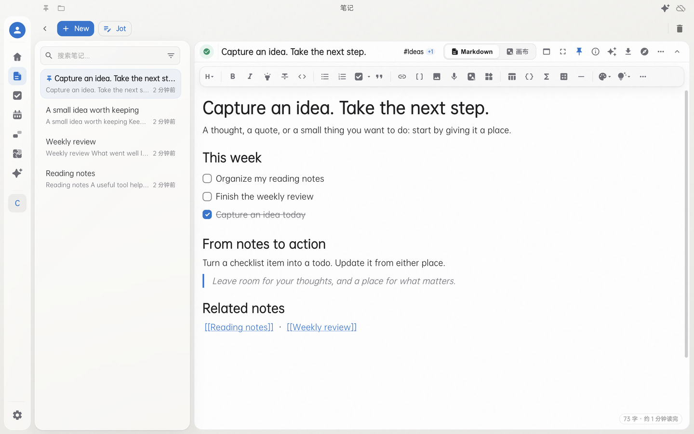
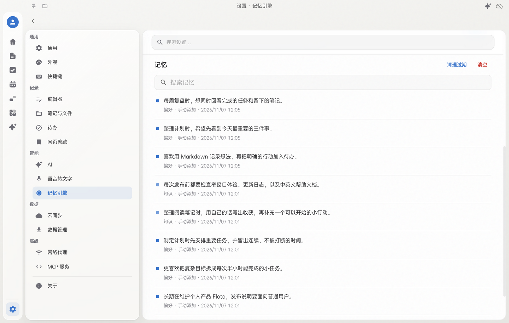
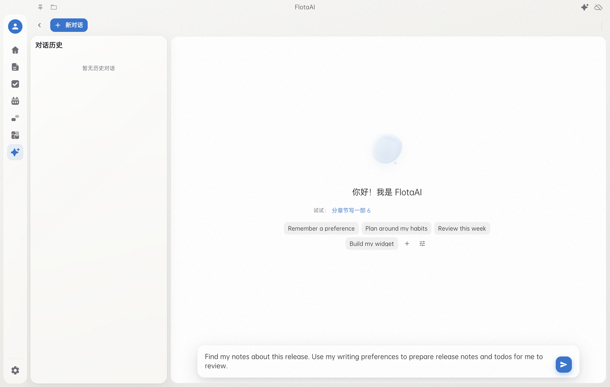
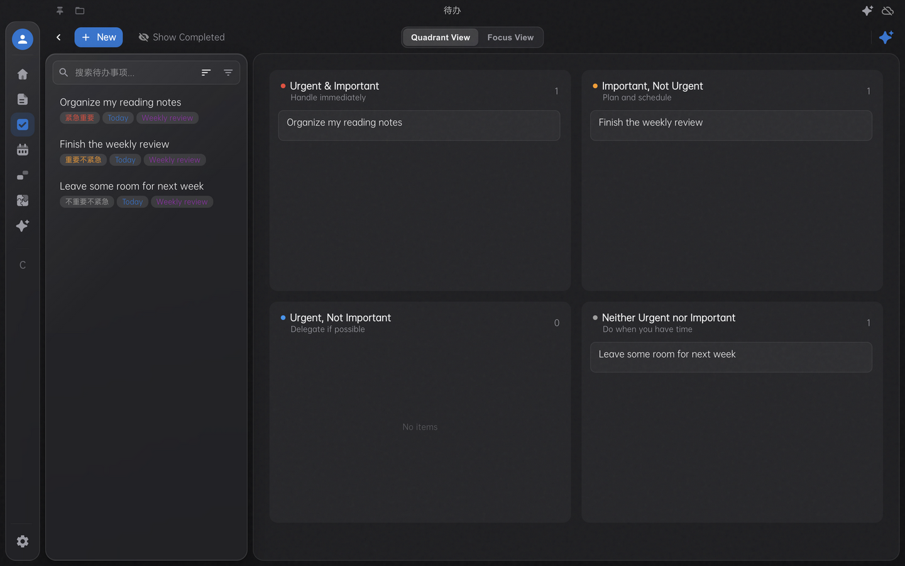
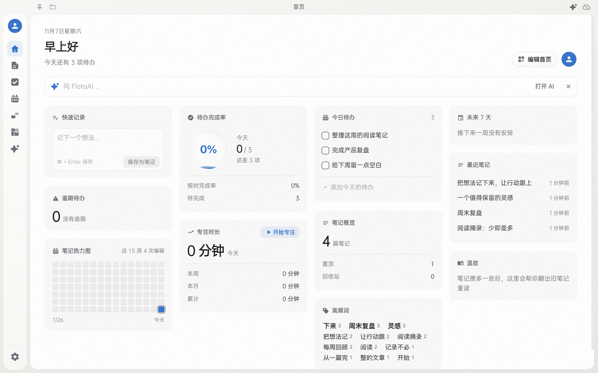

<div align="center">

[中文](./README.md) · [English](./README_EN.md)


# Flota

**A personal agent that learns how you work.**

A local-first home for notes, todos, canvases, and AI that can remember your preferences and help you take the next step.

[Download](https://github.com/Xperiamol/Flota/releases) · [Quick start](#quick-start) · [Changelog](./CHANGELOG.md) · [Privacy](./PRIVACY.md#english)


[](https://github.com/Xperiamol/Flota/releases)

</div>



## Remembers you. Helps you act.

Spend less time explaining yourself again. Tell Flota how you like to write, how you want answers, and what you work on over the long term. In later conversations, AI can draw on those memories to offer more relevant help.

### Useful memory, under your control

- **Keep what matters**: With automatic memory enabled, Flota selects lasting preferences, identity details, and habits from conversations. You can also explicitly ask it to remember something.
- **Recall when relevant**: AI can use memories that relate to your question, reducing repeated background explanations. Ask it to correct a preference when it changes.
- **Manage what it knows**: Browse, search, edit, and delete memories in Settings. Turn automatic memory off or undo a memory update from the conversation.



The memory screen currently uses Chinese labels. Its memories were added manually as demo data. Memories are stored locally; extracting and using them with AI sends relevant content to the provider you configure.

### Work with your notes, then take action

Ask it to find relevant notes, read them in full, and turn them into a plan. Extract todos, revise an existing canvas, or generate a widget for your home page. Write operations produce a confirmation card by default so you can review them before execution.

Try requests such as:

> “Remember: I prefer the conclusion first, followed by three key points.”
>
> “Find this week's release notes and turn the action items into todos for me to review.”
>
> “Turn this plan into a flowchart. Keep the existing content and add only the missing steps.”



The screenshot shows custom prompt shortcuts and an unsent draft; no external AI service was called. AI features require your own endpoint and key. Capabilities and response quality depend on the model you choose.

## From a note to the next step

- **Connect notes and todos**: Turn a checklist item into a todo, with completion and title changes synced both ways. Embed individual todos or dynamic lists in notes.
- **Write and draw**: Use rich-text or Markdown source editing, wiki links, tags, math, code blocks, and Excalidraw canvases.
- **Explore connections**: The knowledge graph connects wiki links, inserted note links, and shared tags. Revisit your work through the timeline and calendar.
- **Make the home page yours**: Arrange cards for quick capture, today's todos, recent notes, focus time, activity, and widgets.
- **Keep control of your data**: Store notes and attachments locally. Choose WebDAV sync, backups to multiple drives, note history, and CalDAV / Google Calendar sync when needed.

## A closer look

Screenshots use an isolated demo profile and the code for version 4.5.4. Some interface labels and AI prompt suggestions are still in Chinese.

### Todos, organized by priority



### Home cards for daily work



The home-page screenshot shows the Chinese interface and sample notes.

## Quick start

### Install

Open [GitHub Releases](https://github.com/Xperiamol/Flota/releases) and choose a package for your operating system and processor:

| Platform | Installation |
| --- | --- |
| Windows 10 or later | Download the Windows installer |
| macOS | Choose the Apple Silicon (arm64) or Intel (x64) DMG and drag Flota into Applications |
| Linux x64 | Download the AppImage and make it executable; your system needs AppImage support |

The Microsoft Store edition is named **Flota Notes** and receives updates through the Store. Available packages depend on the release channel. Android is released separately; this page describes the desktop app.

### Your first session

1. Press `Ctrl/Cmd + N` to create a note, or `Ctrl/Cmd + Shift + N` for quick input.
2. Press `Ctrl/Cmd + T` to create a todo, or add a task from a note to your todos.
3. Configure AI, sync, or speech recognition in Settings when needed. Basic note-taking requires no account or key.
4. Add useful cards to your home page. Shortcuts can be customized in Settings.

### More tools

- **Web Clipper**: Save full pages, selections, or bookmarks with the Chrome / Edge extension. [Installation and pairing](./extensions/chrome-clipper/README.md) (Chinese).
- **Speech to text**: Use local Whisper recognition or Volcengine cloud recognition with your own credentials. Download the model before using offline recognition.
- **Import and export**: Import Markdown, Office documents, PDF, EPUB, and more; export your data or create a local backup.
- **Note history**: Enable snapshots in Settings to browse or restore earlier versions.
- **Plugins and MCP**: Extend your workflows through plugins. When enabled, MCP lets connected AI clients read and change notes and todos.

## Data and privacy

Flota has no account system, analytics, tracking, ads, or crash reporting. Notes, todos, and attachments are stored on your device.

AI, cloud recognition, and sync send relevant data to the services you configure. Offline recognition processes audio locally after the model download. See the [privacy policy](./PRIVACY.md#english) for network features and third-party services.

## Development and contributions

```bash
git clone https://github.com/Xperiamol/Flota.git
cd Flota
npm install
npm run electron-dev
```

`electron-dev` starts both Vite and Electron; a separate `npm run dev` is unnecessary.

- [Development and build guide](./docs/DEVELOPMENT.md#english)
- [Plugin documentation](./plugins/docs/README.md) · [Example plugins](./plugins/examples/)
- [Release workflow](./docs/RELEASE_FLOW.md) (Chinese) · [License](./LICENSE)
- [Report an issue or suggest an improvement](https://github.com/Xperiamol/Flota/issues), including the app version, operating system, and reproduction steps.

## From FlashNote to Flota

The old name, avatar, and interface have a home in the [nostalgia archive](./docs/history/README.md#english), alongside links to the original READMEs.

This page follows the current app. Historical pages are preserved as archives.
