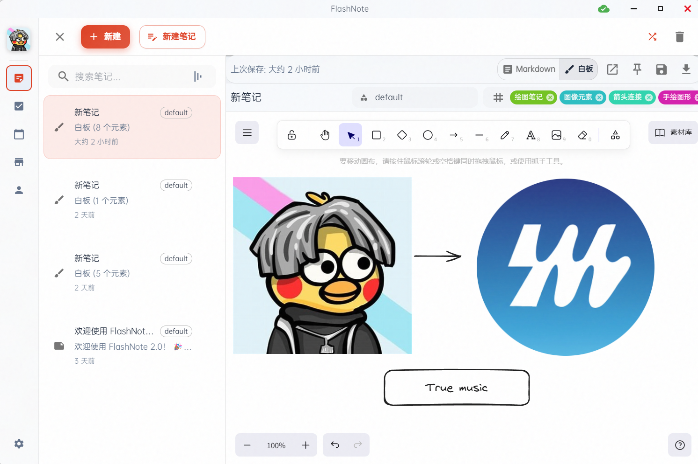
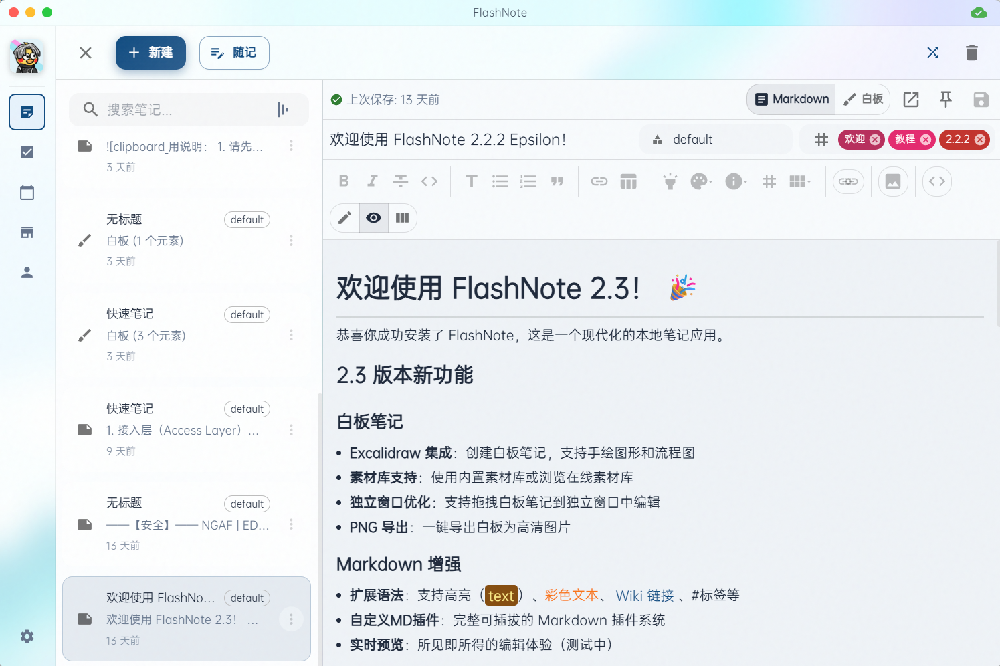

[⬅ 返回当前中文 README](../../README.md) · [⬅ Back to Current English README](../../README_EN.md) · [Jump to English](#english)

# 🕰️ 怀旧版 README：那些年，它还叫 FlashNote

> *“旧的 1.x 版本已经随风而逝了，迎接现在更开放更赏心悦目的新版本。”*  
> —— 摘自 2025 年 11 月 `FlashNote 2.0` 初代 README

这里是一间小小的时光陈列室。

在改名为 **Flota**、长出个人 Agent、长期记忆与双向联动待办之前，这个项目叫 **FlashNote**。那时候它刚刚告别 1.x，重写了整个界面，第一次把 Excalidraw 画布塞进笔记里，也第一次写出了本地插件沙箱和那句有点倔强的致谢——*“创造一个用最小交互完成记录的、有摩擦的笔记应用”*。

为了不让这些可爱的历史痕迹在迭代中彻底消失，我们把当年的经典界面和初代 README 完整保存在了这里。

> 💡 **提示**：本页展示的是 FlashNote 2.x 时期的历史风貌。如果你需要下载最新安装包或查看当前开发文档，请返回 **[当前版 README](../../README.md)**。

---

## 📸 当年的经典界面（FlashNote 2.x 时期）

这两张截图曾陪伴了项目很长一段时间——从 `FlashNote 2.0` 一路用到 `Flota 4.5.3` 才正式退休。

### 1. 刚学会画画的白板画布

当年第一次接入 Excalidraw 白板引擎时的模样。左边是分类极简的笔记列表，右边是手绘感十足的架构草图，顶栏里还挂着初代的图标与蓝色「新建」按钮：

### 2. 写着 `2.2.2` 与 `2.3` 更新笔记的编辑界面

这张图里藏着不少老彩蛋：置顶的 `FlashNote2.2.2` 更新记录、刚加入的阿里云与 Whisper 语音转文字说明、右侧滑出的 AI 聊天侧栏，以及当年被老 README 误标成「Dark Preview」但其实是浅色主题的第二张预览图：

---

## 📜 怀旧版 README 展映（2025-11-21 原文重现）

下面为您原汁原味重现 **2025 年 11 月 21 日** 的 `FlashNote 2.0` 初代 README（已将当年的外链图片替换为上方本地永久归档图）：

<strong>📖 点击展开 / 收起：《FlashNote 2.0》初代中文 README 原文</strong>

 

<blockquote>

### FlashNote 2.0

一个现代化的桌面笔记应用，专为高效记录和管理笔记而设计。  
旧的 1.x 版本已经随风而逝了，迎接现在更开放更赏心悦目的新版本。

#### 🌟 主要特性

- **📝 智能笔记编辑**
  - **富文本编辑器**：支持 Markdown 语法，实时预览
  - **白板编辑器**：Excalidraw 作为白板引擎，支持白板、绘图等功能
  - **快速格式化**：一键应用粗体、斜体、下划线等格式
  - **丰富 MD 格式**：Wiki 链接、标签、彩色文本、Callout 等
  - **自动保存**：实时保存，永不丢失内容
- **🎯 高效操作**
  - **全局快捷键**：随时随地快速创建笔记（`Ctrl+N` 新建、`Ctrl+Shift+N` 快速输入）
  - **系统托盘**：最小化到托盘，后台运行不占用任务栏
  - **快速搜索**：全文搜索，快速定位所需内容
- **🎨 个性化定制**
  - **主题切换**：支持亮色 / 暗色主题 / 强调色
  - **快捷键配置**：个性化快捷键设置
  - **预装背景插件**：提供多种纹路背景插件，美化你的笔记界面
- **📊 数据管理**
  - **本地 SQLite 存储**：数据安全存储在本地
  - **向量存储**：使用 `@xenova/transformers` 在本地设备上进行文本向量化
  - **本地 Mem0Service 集成**：实现基于余弦相似度的语义搜索和记忆管理系统
- **📅 日历同步 & 🎤 语音转文字（v2.2.2+）**
  - 支持 CalDAV（iCloud、Nextcloud）与 Google Calendar 双向同步
  - 支持 OpenAI Whisper、阿里云语音识别及插件 API 调用

#### 🙏 致谢

感谢所有使用过这个项目 demo 的用户！我们致力于创造一个用最小交互完成记录的、有摩擦的笔记应用。

**FlashNote 2** - 让笔记记录变得更加高效和愉悦！如果这个项目对你有帮助，请给我们一个 ⭐️！

</blockquote>

---

## 🗂️ 历代版本 README 档案馆

如果你想查阅一字未改的原始文件或浏览当时的代码树，可以通过下方时间线直达：

| 时期与版本 | 节点记忆 | 原始文件 / Git 快照 |
| --- | --- | --- |
| **2025-11-21 · FlashNote 2.0** | 告别 1.x，引入 Excalidraw 白板、本地向量检索、CalDAV 同步、语音转文字与初代插件系统 | [📄 本地中文原文](./flashnote-2025-11-21-zh.txt) · [Git Commit `2197971`](https://github.com/Xperiamol/Flota/blob/219797179d44541bb0d60bcc7bfe9316cb0a8231/README.md) |
| **2025-11-21 · FlashNote 2.0 (EN)** | 初代英文版 README | [📄 Local English Raw](./flashnote-2025-11-21-en.txt) · [Git Commit `fd4cba9`](https://github.com/Xperiamol/Flota/blob/fd4cba9699c27d2577440a93ac665bbc9ec8b1fe/README_EN.md) |
| **2026-11-06 · Flota 4.5.3** | 已更名为 Flota，确立双栏特性表格与完整工程文档，但仍最后一次沿用上面两张老截图 | [Git 中文版 `436e599`](https://github.com/Xperiamol/Flota/blob/436e59978c3a3f4b16dced3d267505475528be16/README.md) · [Git 英文版 `436e599`](https://github.com/Xperiamol/Flota/blob/436e59978c3a3f4b16dced3d267505475528be16/README_EN.md) |
| **当前版本 · Flota 4.5.4+** | 全新个人 Agent、长期记忆、AI 生成桌面组件、笔记待办双向联动与新界面截图 | [👉 前往当前中文 README](../../README.md) · [👉 Current English README](../../README_EN.md) |

---

# 🕰️ Nostalgia Edition: When Flota Was Called FlashNote

> *"The old 1.x version has been phased out. Welcome to the new version that is more open and visually appealing!"*  
> — From the original `FlashNote 2.0` README (November 2025)

Welcome to Flota's time capsule.

Before rebranding to **Flota** and growing into a personal workspace with an AI agent, manageable long-term memory, and two-way linked todos, this project was known as **FlashNote**. Back then, it had just left `1.x` behind, debuted a redesigned UI, embedded the Excalidraw whiteboard into notes for the first time, and introduced a sandboxed plugin system.

We built this page to keep those early milestones, classic screenshots, and the original README text alive.

> 💡 **Note**: Everything on this page reflects the historical **FlashNote 2.x** era. For current downloads, features, and developer docs, head back to the **[Current English README](../../README_EN.md)**.

---

## 📸 Classic Screenshots from the FlashNote 2.x Era

These two screenshots were the face of the repository from the `FlashNote 2.0` launch all the way through `Flota 4.5.3`:

1. **The First Excalidraw Canvas Integration** *(see the first screenshot above)* — Showing the early sidebar layout, blue "New" button, and a hand-drawn system diagram on the canvas.
2. **Release Notes for `2.2.2` & `2.3` in the Editor** *(see the second screenshot above)* — Featuring the pinned `FlashNote2.2.2` changelog note, early Whisper / Alibaba Cloud speech-to-text notes, and the slide-out AI chat panel on the right.

---

## 📜 Original `FlashNote 2.0` README (Nov 21, 2025)

<strong>📖 Click to expand / collapse: Original English README from FlashNote 2.0</strong>

 

<blockquote>

### FlashNote 2.0

A modern desktop note-taking application designed for efficient note recording and management.  
The old 1.x version has been phased out. Welcome to the new version that is more open and visually appealing!

#### 🌟 Key Features

- **📝 Smart Note Editing**: Rich Text Editor with live Markdown preview, Excalidraw Whiteboard Editor, quick formatting, Wiki links, tags, colored text, Callouts, and real-time auto-save.
- **🎯 Efficient Operations**: Global shortcuts (`Ctrl+N` for new note, `Ctrl+Shift+N` for quick input), system tray background mode, and full-text search.
- **🎨 Personalized Customization**: Light/dark themes, accent colors, customizable shortcuts, and pre-installed texture background plugins.
- **📊 Data Management**: Local SQLite storage, local text vectorization via `@xenova/transformers`, and local `Mem0Service` semantic search & memory management.
- **📅 Calendar Sync & 🎤 Speech-to-Text (v2.2.2+)**: Two-way CalDAV (iCloud, Nextcloud) and Google Calendar sync; OpenAI Whisper & Alibaba Cloud speech recognition with plugin API support.

#### 🙏 Acknowledgments

Thanks to all users who have used this project demo! We are committed to creating a note-taking app with minimal interaction for recording and intentional design focus.

**FlashNote 2** - Make note-taking more efficient and enjoyable! If this project helps you, please give us a ⭐️!

</blockquote>

---

## 🗂️ Historical Timeline & Raw Snapshots

| Era & Version | Highlights | Raw Text / Git Snapshot |
| --- | --- | --- |
| **2025-11-21 · FlashNote 2.0 (EN)** | The original `2.0` English README introducing Excalidraw, local vectors, CalDAV sync, and plugins | [📄 Local Raw Text](./flashnote-2025-11-21-en.txt) · [Git Commit `fd4cba9`](https://github.com/Xperiamol/Flota/blob/fd4cba9699c27d2577440a93ac665bbc9ec8b1fe/README_EN.md) |
| **2025-11-21 · FlashNote 2.0 (ZH)** | The original `2.0` Chinese README | [📄 Local Raw Text](./flashnote-2025-11-21-zh.txt) · [Git Commit `2197971`](https://github.com/Xperiamol/Flota/blob/219797179d44541bb0d60bcc7bfe9316cb0a8231/README.md) |
| **2026-11-06 · Flota 4.5.3** | Rebranded to Flota with a two-column feature matrix, right before retiring the classic FlashNote screenshots | [Git English `436e599`](https://github.com/Xperiamol/Flota/blob/436e59978c3a3f4b16dced3d267505475528be16/README_EN.md) · [Git Chinese `436e599`](https://github.com/Xperiamol/Flota/blob/436e59978c3a3f4b16dced3d267505475528be16/README.md) |
| **Today · Flota 4.5.4+** | Personal Agent, manageable long-term memory, AI-built widgets, two-way linked todos, and refreshed native screenshots | [👉 Current English README](../../README_EN.md) · [👉 当前中文 README](../../README.md) |
